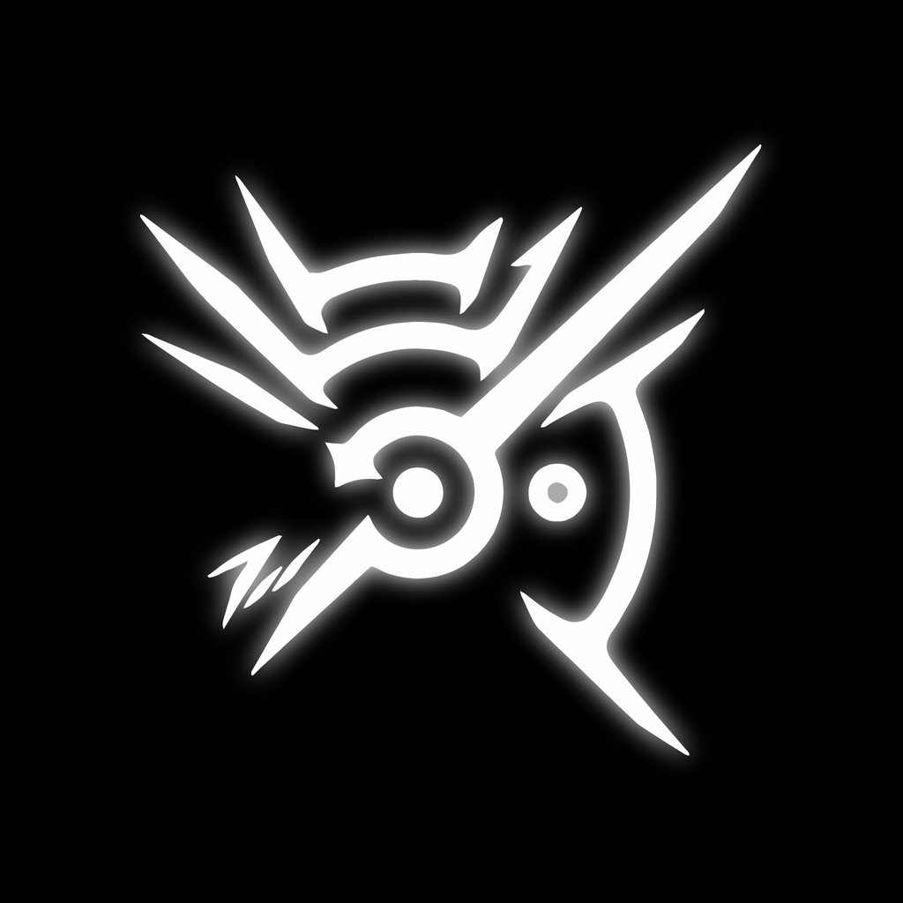

<div align="center">



# DiOShonored

**Dishonored (2012) on iPhone, from your own copy of the PC game.**

[](https://github.com/OMetaVR/DiOShonored/releases)
[](https://github.com/OMetaVR/DiOShonored/actions/workflows/build.yml)


[](LICENSE)

</div>

> [!IMPORTANT]
> **Unofficial fan project.** DiOShonored is not affiliated with, endorsed by or connected to Arkane Studios, Bethesda
> Softworks or ZeniMax Media. *Dishonored* and all related names, art and code are their property.
> **This repository contains no game code and no game data, and it never will.** To play you need your own legal copy of
> Dishonored for PC on Steam; the app runs that copy.

## What this is

DiOShonored runs the Steam (PC) release of Dishonored natively on iPhone. It is not an emulator and not a port of the game's
source code. It is a **static recompiler** plus a compatibility layer:

- **Recompiler** (`lifter/`, Rust): translates the game's 32-bit x86 Windows program (`Dishonored.exe` and its DLLs) into C,
  which is compiled for the iPhone's ARM processor. This runs on *your* computer, on *your* files.
- **Runtime** (`runtime/`, C++): the parts of Windows the game expects (files, threads, memory, input, audio, Steam in offline
  mode), and a Direct3D 9 to **Metal** renderer with ASTC texture transcoding and MetalFX upscaling.
- **iOS app** (`ios/`): imports the game files you copy onto the phone, checks them against the supported Steam build,
  and starts the game. Controllers (tested with a Backbone One) and touch are supported.

### Why it is not piracy

| Distributed here | Not distributed, ever |
| --- | --- |
| The recompiler, the runtime, the iOS app shell, tools, docs | `Dishonored.exe`, its DLLs, or any code translated from them |
| An app shell IPA that cannot play anything by itself | Game data: packages, textures, audio, movies, saves |

The playable app contains code translated from the game's executable, so each player builds it from their own copy and keeps it
to themselves. The game data stays on the player's phone, copied from their own install. The app verifies the game files by
SHA-256 against the supported Steam build and refuses anything else.

## Status

Early beta. Tested on one device so far.

| | |
| --- | --- |
| **Device** | iPhone 13 (A15 Bionic, 4 GB), iOS 27.0.1, sideloaded with SideStore + LiveContainer, Backbone One controller |
| **Works** | Boot, intro movies, menus (Scaleform UI), New Game, mission briefings, loading into and playing the first mission |
| **Performance** | 42-52 fps in the first mission at 1558x720 (MetalFX-upscaled to 2532x1170); memory about 1.1 GB *(build dev9, being re-measured with the current build)* |
| **Render resolution** | 720 lines by default (best balance on A15-class phones), upscaled by MetalFX; set `render_height` in `DishonoredData/dish_settings.ini` (900 / 1080 / 1170 for sharper, at a GPU and memory cost) |

### Known issues

- **Saving** (new in this build): autosaves, quicksaves and options are written to `DishonoredData/SteamCloud/`. Dishonored keeps
  its saves in Steam Cloud, so these are the same file names Steam uses: you can copy your own PC saves from
  `Steam/userdata/<id>/205100/remote/` into that folder to continue there. Verified on Linux, being verified on iPhone.
- Linux development builds can crash in PhysX right as gameplay starts (about half the runs); under investigation. Not seen on
  iPhone so far.
- Stutter the first time an area is seen, while its shaders compile. A shader preparation step at launch (like DXVK's state
  cache) compiles everything recorded in earlier sessions, so revisited areas are smooth.
- Not 60 fps yet; CPU and GPU optimisation is ongoing.
- DLC is not detected (offline Steam layer).

## Install

1. **Build the playable app** (below) or, to try the shell only, download `DiOShonored-shell.ipa` from
   [Releases](https://github.com/OMetaVR/DiOShonored/releases) (pre-release, beta).
2. Sideload the IPA with [SideStore](https://sidestore.io) / [LiveContainer](https://github.com/LiveContainer/LiveContainer),
   AltStore or any signer. The IPA is unsigned and has no `Frameworks/` folder.
3. In the Files app, open the app's folder (*On My iPhone* > *Dishonored*, or the app's Documents under LiveContainer) and copy
   the **contents of your Dishonored install folder** into `Dishonored/` (it must contain `Binaries/Win32/Dishonored.exe` and
   `DishonoredGame/`). The app checks the files and starts the game.

Logs, settings and saves live in `DishonoredData/` next to it.

## Build the playable app

You need your own copy of **Dishonored for PC (Steam)**, a Mac with Xcode, CMake, Ninja and Rust:

```sh
brew install cmake ninja rustup && rustup-init -y
git clone https://github.com/OMetaVR/DiOShonored && cd DiOShonored
ci/build_ios.sh --game "/path/to/steamapps/common/Dishonored"
# -> build/DiOShonored.ipa  (contains code translated from your Dishonored.exe: keep it to yourself)
```

Only `Binaries/Win32` is read on the computer; the game data is copied to the phone separately (step 3 above). Building on Linux
is possible too (cross-compiled with an iPhoneOS SDK extracted from Xcode); see `research/platform/ios_toolchain.md` and
`ios/game/scripts/build_ipa.sh`.

<details>
<summary>Developer notes</summary>

- Linux runtime + tests: `cmake -S runtime -B build/rt -G Ninja -DDISH_USE_GENERATED=OFF && ninja -C build/rt && ctest --test-dir build/rt`
- Run the recompiled game on Linux (DXVK-native): `lifter/regen.sh`, then `lifter/tests/devrun.sh generated <seconds>`
- Design docs: `PLAN.md`, `docs/` (guest ABI, recompiler, runtime, Direct3D 9 backend)
- Diagnostics: `DISH_LOG`, `DISH_FRAME_DUMP`, `DISH_D3D9_TRACE_FRAME`, `DISH_PROFILE` (sampling profiler), `DISH_DEV_KEYS` (scripted input)

</details>

## Thanks

To **Arkane Studios** and everyone who made Dishonored, and to **Bethesda Softworks / ZeniMax Media**, who own it: this is a
passion project, made out of love for these games, with one goal: letting people who own Dishonored play it on the go. If you
don't own it, please [buy it on Steam](https://store.steampowered.com/app/205100/Dishonored/); it is still one of the best
games ever made.

## Credits

- **App icon**: the Outsider's mark, from a wallpaper shared on Reddit
  ([image](https://i.redd.it/7lki22b9b3cy.png)), cropped to a square. The mark itself is Arkane's design.
- [SDL 3](https://libsdl.org) (zlib): windowing, input, controllers, audio
- [MojoShader](https://github.com/icculus/mojoshader) (zlib): Direct3D 9 shader parsing, vendored in `external/mojoshader`
  with local changes
- [DXVK](https://github.com/doitsujin/dxvk) (zlib): Direct3D 9 headers, vendored in `external/dxvk-headers`; DXVK-native is
  the Linux reference renderer
- [iced-x86](https://github.com/icedland/iced) (MIT): x86 decoding in the recompiler
- [ARM astc-encoder](https://github.com/ARM-software/astc-encoder) (Apache 2.0): reference decoder used to validate the ASTC
  transcoder (tests only)

## License

The code in this repository is MIT licensed (see [LICENSE](LICENSE)). Vendored third-party code keeps its own license. The
license covers this project's code only; it grants nothing in Dishonored, which remains the property of its owners.
